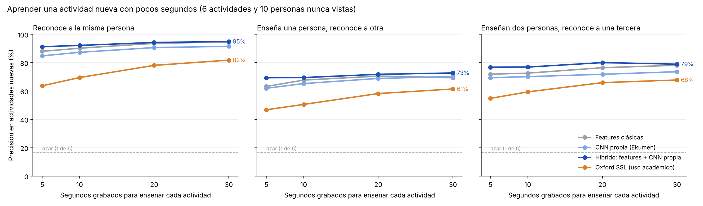

# Ekuthon 2026 - ML Motion Replay

**Learn activities. Recognize them. Test your precision**

A demo for the Ekumen Technical Showcase. Participants scan the **JOIN US** QR code, strap a phone to their forearm like a smartwatch, and repeat a movement for 20 seconds. The model adds it to its activity library in real time with its existing weights. On the big screen, an embedding map shows each participant moving toward the cluster for the activity they are performing. In **Guided exercise**, participants imitate a recorded movement and get a score based on timing, range, and shape.

The demo combines wearable motion sensors, embeddings, few-shot learning with prototypes, open-set activity recognition, and real-time signal processing.

## How it works

```text
Phone (browser)              Laptop (server)                                  Big screen
Accelerometer at ~60 Hz ──WS──▶ Resample to 30 Hz in g → 5 s window → encoder → embedding
Batches every 200 ms         Compare with prototypes using cosine similarity   Dashboard /panel
                             Below threshold → "Unknown"              ──WS──▶ 2D map and cards
                             Record for 20 s → average embeddings → new prototype
```

- Activity recognition saves prototypes and their labels in `data/prototypes.json`. Guided exercise saves reference curves, phase labels, and scores in `data/exercises.json`.
- Each teaching recording produces one prototype. When two people teach the same movement, the classifier uses the closest of their prototypes. The offline results show how this helps when a third person performs the activity.

## Setup (about 5 minutes)

Requires Python 3.10 or later and Git.

```bash
pip install -r requirements.txt
python scripts/prepare_wisdm.py  # Download WISDM and build data/wisdm_watch_30hz.npz (~1 min)
```

The trained models are included in `models/`. To retrain or reproduce the evaluation:

```bash
python scripts/train_encoder.py --mode eval    # ~4 min on CPU, with 6 activities and 10 people held out
python scripts/train_encoder.py --mode deploy  # ~4 min on CPU, using all data for the demo
python scripts/evaluate_fewshot.py              # Generate results/fewshot.png and the thresholds
```

## Run the demo

```bash
python app/server.py  # Uses the hybrid encoder by default
cloudflared tunnel --url http://localhost:8000
```

The tunnel prints a public HTTPS address such as `https://example.trycloudflare.com`. **Open the dashboard at that address**, for example `https://example.trycloudflare.com/panel`. The QR code points to the host used to open the dashboard.

Phones need an HTTPS connection to grant access to motion sensors. You can also use `ngrok http 8000`. [Install cloudflared](https://developers.cloudflare.com/cloudflare-one/connections/connect-networks/downloads/)

### Try it without phones

The simulator streams real WISDM recordings as if they came from connected phones. Its activity arguments use the labels stored in the dataset. The example plays clapping, walking, and dribbling a basketball.

```bash
python scripts/simulate_phones.py --phone "Alex=Aplaudir:30,Caminar:30" --phone "Sam=Picar una pelota:60"
```

### End-to-end tests

```bash
python scripts/e2e_test.py
python scripts/e2e_exercise.py
```

The recognition test has three simulated participants teach activities and four others perform the same activities or an unknown one. The guided exercise test uses synthetic sensor signals. Run `python scripts/e2e_exercise.py --keep` to leave the dashboard running at `http://localhost:8000/panel`.

## Suggested demo (5 minutes)

1. Show the **JOIN US** QR code. Have two or three people connect and strap a phone to their forearm.
2. Ask someone to invent a distinct, repeatable movement, such as dribbling an imaginary ball, writing in the air, or stirring a pot. Enter the name on their dashboard card and click **Teach**. A 3-second countdown starts a 20-second recording.
3. When the new cluster appears on the map, have the participant repeat the activity and watch their circle move toward it.
4. Have someone try an activity that has yet to be taught. Use the **Unknown** label to explain open-set recognition.
5. Ask a second person to teach the same movement, then have a third person try it.
6. Close with the offline results for six activities and ten people held out during training. [Few-shot results chart](results/fewshot.png)

## Offline evaluation



We evaluated on wrist-worn WISDM 2019 data from six activities and ten participants held out during training. The accuracy columns measure classification among the six newly taught activities.

| Encoder | Same person, 20 s | One teacher, different person, 20 s | Two teachers, third person, 20 s | Unknown detection (AUROC) |
|---|---|---|---|---|
| **Hybrid: handcrafted features + custom CNN** (default) | **94%** | **72%** | **80%** | **0.97** |
| Handcrafted features | 94% | 71% | 76% | 0.94 |
| Custom CNN (Ekumen) | 91% | 69% | 72% | 0.94 |
| Oxford SSL, harnet5 (academic use only) | 78% | 58% | 66% | 0.80 |

- The hybrid encoder reached 91% accuracy with five seconds of teaching data when the same person performed the activity.
- With 20 seconds of teaching data and a different person performing the activity, accuracy varied by movement. Handwriting reached 98%, dribbling a basketball 92%, folding clothes 69%, kicking a ball 62%, clapping 55%, and brushing teeth 54%.
- The hybrid encoder performed best overall. The evaluation used the Oxford model as a feature extractor with frozen weights.

[Detailed metrics](results/fewshot_metrics.json)

## Before the event

- Bring one phone armband per participant onstage and a spare phone.
- Test sensor permissions, calibration, and screen wake lock on an iPhone and an Android phone.
- Rehearse with people who did not build the project.
- Use **Controls** to adjust the unknown threshold. Lower it if known activities are frequently labeled **Unknown**. Raise it if unfamiliar movements are frequently assigned a known label. The starting threshold for the hybrid encoder is 0.64.
- Keep the simulator ready in case the network fails.
- Click **Clear all** before the demo if you want to start with an empty activity library.

## Technical details

- **Windows** contain 5 seconds of acceleration at 30 Hz, with 150 samples across each of three axes in units of g, including gravity. The system classifies once per second and uses the last three predictions to stabilize the displayed label.
- **Phone calibration** standardizes the accelerometer sign across devices. Place the phone face up for two seconds to set the convention to +1 g on the z-axis.
- **Hybrid encoder** concatenates 67 standardized handcrafted features, including statistics, spectral features and axis correlations, with a 128-dimensional embedding from a 1D CNN. The CNN uses four convolutional blocks and a cosine classifier. Training augments signals with rotations of up to 30 degrees, noise, and scaling.
- **Unknown detection** returns **Unknown** when similarity to the closest prototype falls below the threshold.
- **Embedding map** uses a 2D PCA projection that updates when the activity library changes.
- **Base activities (experimental)** loads Walking, Jogging, Standing, Clapping, and Brushing teeth from WISDM. The examples come from wrist-worn watches, so test recognition with the phone mounted on the forearm.
- Pass `--encoder features|ekumen|hybrid|oxford` to `app/server.py` to choose an encoder.

## Project structure

```text
app/
  server.py        FastAPI and WebSockets for the phone and dashboard
  engine.py        Windows, embeddings, prototypes, recording, and the 2D map
  exercise.py      Guided exercise, rep segmentation, phases, DTW, and scoring
  encoders.py      Handcrafted features, custom CNN, hybrid, and Oxford
  dsp.py           Resampling, windowing, and feature extraction
  static/phone.html, static/panel.html
scripts/
  prepare_wisdm.py, train_encoder.py, evaluate_fewshot.py, simulate_phones.py, e2e_test.py
  simulate_exercise.py, e2e_exercise.py   Synthetic motion and guided exercise testing
models/            Trained checkpoints, normalization statistics, and thresholds
results/           Evaluation chart and metrics
```

## Guided exercise

Open **Guided exercise** on the dashboard. You can save multiple reference movements. Participants choose a reference and imitate it with or without tempo. References and leaderboards persist across server restarts.

### Record a reference

1. Click **Record reference** on the demonstrator’s card.
2. Have them hold still for about two seconds to calibrate, then perform the movement. They can pause mid-movement and finish in any position.
3. Click **Finish** when they are done. The **Save movement** dialog shows the curve and detected phases. Enter a name, optionally rename the phases, then click **Save** or **Discard**.
4. Select a saved movement on the right to see its curve and leaderboard. Click **Delete** twice to remove it.

The system trims the still period between the end of the movement and the click on **Finish**.

### Imitate a movement

1. Click **Imitate…** on another participant’s card. Choose a reference and a scoring mode.
   - **With tempo** scores phase timing (40%), range (30%), and shape (30%).
   - **Without tempo** scores shape (60%) and range (40%). Phase times are shown for reference.
2. Have the participant hold still for two seconds, then repeat the movement as many times as they like. Each rep ends when any of these conditions is met.
   - They return to the starting position and hold still for 0.35 seconds after completing as many movement segments as the reference.
   - They hold still in any position for at least 1.5 times the longest pause in the reference, with a minimum of 2.5 seconds. For a 5-second reference pause, this takes 7.5 seconds.
   - You click **End rep**.
3. Click **Finish** to end the participant’s session. Each reference has a leaderboard for each scoring mode.

**Phone placement.** Attach the phone to the moving body part. Use the forearm for hand or arm movements, or the thigh or front pocket for a squat. Keep the placement consistent between the demonstrator and participant. The scoring signals tolerate different phone orientations at the same placement.

### What it measures

- **Signals.** The system estimates the phone’s tilt from its resting position using gravity, its rotational speed from the gyroscope or changes in gravity, and the magnitude of acceleration after removing the gravity estimate.
- **Rep boundaries.** The system trims each rep using a threshold of 10% of its peak rotational speed, subject to a minimum threshold.
- **Phases.** Internal pauses separate phases. For movements without pauses, the system can split the rep into outward and return phases at peak tilt.
- **Comparison.** Dynamic Time Warping (DTW) aligns the attempt and reference curves so the system can compare corresponding phase durations.

### Validation with synthetic motion

`python scripts/e2e_exercise.py` tests participants with the phone mounted at different orientations.

| Reference | Attempt | Mode | Total | Timing | Range | Shape |
|---|---|---|---|---|---|---|
| Raise your hand (2 / 1 / 2 s, 90°) | Same movement | With tempo | 99% | 96% | 100% | 100% |
| Raise your hand | Twice as fast | With tempo | 66% | 23% | 92% | 97% |
| Raise your hand | Twice as fast | Without tempo | 95% | Unscored | 92% | 97% |
| Two 5-second pauses | Pauses of 6 and 4 s | With tempo | 95% | 88% | 100% | 100% |
| Finishes in the raised position | Same movement | With tempo | 97% | 94% | 100% | 100% |

A 2/1/2-second profile measures as 1.9/1.1/1.9 seconds. A 4/2/3-second profile measures as 3.6/2.3/2.8 seconds. Thresholds trim the gradual starts and stops in both the reference and the attempt.

**Movement limits.** The demo works best when the body part carrying the phone rotates. Sliding a hand straight ahead with a fixed orientation gives a weaker signal. A short pause at the starting position helps the system distinguish consecutive reps.

**Live controls.** Raise the **Stillness threshold** if the system struggles to detect that someone is holding still. Raise the **Minimum pause threshold** if small movements during a hold cause missed pauses. Use **Timing strictness** to adjust how sharply timing differences affect the score.

## Licenses and credits

- **WISDM Smartphone and Smartwatch Activity and Biometrics Dataset**, Gary Weiss (2019), UCI Machine Learning Repository, CC BY 4.0. The preparation script retrieves the raw files from a GitHub mirror. [Original dataset](https://doi.org/10.24432/C5HK59)
- **Custom encoder and handcrafted features** are part of this project. Credit WISDM when using the model or sharing material derived from the dataset.
- **Oxford ssl-wearables** is optional. Copyright © 2022, University of Oxford. Licensed for academic use only. To run the comparison, clone `https://github.com/OxWearables/ssl-wearables` into `vendor/ssl-wearables` and run `python app/server.py --encoder oxford`. [Oxford ssl-wearables](https://github.com/OxWearables/ssl-wearables)
